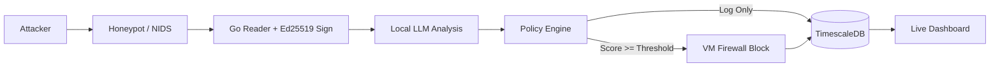

# InDeception
### AI-Assisted Deception & Autonomous Defense System

> An autonomous cybersecurity infrastructure that lures attackers into a controlled environment, analyzes their behavior using a local LLM, and autonomously enforces defensive actions based on validated risk scoring.

**PFE Project — IRS3 | ISIMA | 2026–2027**  

**⚠️ Status: Active Development**

---

## 🔍Overview

InDeception transforms passive honeypots into an intelligent defense platform. Instead of merely logging attacks, it:

- Deploys deceptive services (SSH, network) inside an isolated Ubuntu server 26 VM
- Captures and cryptographically signs all telemetry at ingestion
- Sends normalized events to a local LLM for behavioral analysis and risk scoring
- Enforces time-limited firewall blocks via a deterministic Go policy engine
- Provides real-time visibility through a live SOC dashboard

All detection, orchestration, and enforcement occur exclusively within the Ubuntu VM. The Fedora host serves only as an external LLM inference endpoint and attack simulation source.

## Tech Stack

| Layer | Technology |
| :--- | :--- |
| **Core Language** | Go 1.22+ |
| **Honeypot** | Cowrie (Python-based, configured via shell) |
| **NIDS** | Snort 3 (Lua rules + JSON output) |
| **AI Analysis** | Ollama (local LLM inference) |
| **Database** | TimescaleDB (PostgreSQL extension) |
| **Dashboard** | HTML/CSS/JavaScript + WebSocket |
| **Infrastructure** | Ubuntu Server VM, iptables/nftables, ipset |
| **Signing** | Ed25519 (Go stdlib `crypto/ed25519`) |
| **Version Control** | Git + GitHub |

## Current Progress

### Implemented
- Cowrie SSH Honeypot: Fake terminal capturing commands, credentials (hashed), and file uploads
- Snort3 NIDS: JSON-formatted alerts for SYN/NULL/Xmas/FIN scans and SSH brute-force
- Go Cowrie/snort Log Readers: Tail-f ingestion with JSON unmarshaling and event normalization
- automated bash script that opens multiple tmux windows wish contains ssh conections, real time log viewing..
- Project Skeleton: Modular Go structure (cmd/, internal/), sanitized configs, documentation

### Planned / In Progress
- [ ] Ed25519 Signing Infrastructure: Key generation, signing at reader level, verification CLI
- [ ] Go orchestrator pipeline (event aggregation, LLM dispatch)
- [ ] Ollama integration (structured JSON output, prompt engineering)
- [ ] Policy engine (risk thresholds, allowlist, confidence validation)
- [ ] Firewall enforcer (ipset/nftables with TTL inside Ubuntu VM)
- [ ] TimescaleDB Schema: Hypertables for signed events and firewall actions with expiration tracking
- [ ] Real-time WebSocket server + SOC dashboard
- [ ] End-to-end testing and demo scenario

## Security Principles

- Log Integrity: All events signed with Ed25519 at ingestion; tamper-evident audit trail
- Confidentiality: Local LLM only; no cloud exfiltration; credentials hashed before storage
- Deterministic Enforcement: LLM advises; Go policy engine enforces with minimum confidence + allowlist checks
- Isolation: Core security stack confined to Ubuntu VM; host LLM endpoint restricted to internal network

---

## License

MIT License — see LICENSE for details.

---
## Contributing & Feedback

This project is actively evolving as part of an academic PFE. I welcome:

-  **Ideas**: Better detection logic, LLM prompt improvements, dashboard features
-  **Code contributions**: Bug fixes, performance optimizations, new integrations
-  **Documentation**: Clarifications, architecture diagrams, setup guides
- ️ **Security reviews**: Threat model feedback, bypass scenarios, hardening suggestions

> ⚠️ **Note**: This is a learning project — don't expect production grade stability yet. But every suggestion helps shape better defensive tooling.

For direct discussion: open a GitHub Discussion or reach out via my email malekskwork@gmail.com .
Built for PFE — IRS3, ISIMA | 2026–2027
