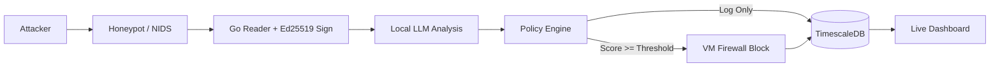

# InDeception

### LLM-assisted SSH deception with a deterministic Go policy engine. Research prototype.

An autonomous cybersecurity infrastructure that lures attackers into a controlled environment, analyzes their behavior using a local LLM, and enforces defensive actions through a deterministic policy engine. Risk scoring evaluation is planned.

**Status:** Active development (prototype)

## Research question

Can a language model running locally score SSH attacker behavior well enough to trigger automatic, time-limited blocks, and how often does it wrongly block a legitimate session?
 - Does the model's risk score separate attackers from normal sessions better than a simple rule-based score?
 - How often does it block a normal session, and how often does it let a real attacker through?
 - How long does it take from the attacker’s first action to the block, and is that fast enough to matter?
 - Does a small model on ordinary hardware perform nearly as well as a bigger one?

## Evaluation plan (planned)

- **Attack sessions:** scans, SSH brute force, scripted post-login commands
- **Normal sessions:** scripted admin work like ls, apt update, editing files, created by me since a honeypot has no real users
- **Metrics:** precision, false-block rate, miss rate, time-to-block
- **Baseline:** simple rule-based score, counting failed logins and suspicious commands
- **Models compared:** 2-3 Ollama models of different sizes

## Threat model

 **Attacker:** remote attacker with no valid credentials on the real system, who may log into the honeypot
 **Defended asset:** the real SSH service (port 2222) on the Ubuntu VM, with the honeypot on port 22
 **Out of scope:** kernel exploits, VM escape, encrypted C2 analysis

## Target architecture

InDeception turns a passive honeypot into an adaptive defense pipeline. When complete it will:
 Deploy a deceptive SSH service (Cowrie) inside an isolated Ubuntu Server 26 VM, with Snort 3 for network scan detection
 Sign all telemetry cryptographically at ingestion
 Send normalized events to a local LLM for behavioral analysis and risk scoring
 Enforce time-limited firewall blocks through a deterministic Go policy engine
 Offer optional real-time visibility through a SOC dashboard

All detection, orchestration and enforcement run inside the Ubuntu VM. The Fedora host serves only as the LLM inference endpoint and attack simulation source.

## Tech stack

| Layer | Technology |
| :--- | :--- |
| **Core language** | Go 1.22+ |
| **Honeypot** | Cowrie (Python-based, configured via shell) |
| **NIDS** | Snort 3 (Lua rules + JSON output) |
| **AI analysis** | Ollama (local LLM inference) |
| **Database** | TimescaleDB (PostgreSQL extension) |
| **Dashboard** | HTML/CSS/JavaScript + WebSocket (optional) |
| **Infrastructure** | Ubuntu Server VM, iptables/nftables, ipset |
| **Signing** | Ed25519 (Go stdlib `crypto/ed25519`) |

## Current progress

### Implemented
 - Cowrie SSH honeypot: fake terminal capturing commands, credentials (hashed) and file uploads
 - Snort 3 NIDS: JSON alerts for SYN/NULL/Xmas/FIN scans and SSH brute force
 - Go log readers (`goLogreaders/`): tail-f ingestion of Cowrie and Snort logs, JSON unmarshaling, event normalization

### Planned
 - Ed25519 signing: key generation, signing at reader level, verification CLI
 - Go orchestrator pipeline: event aggregation, LLM dispatch
 - Ollama integration: structured JSON output, prompt engineering
 - Policy engine: risk thresholds, allowlist, confidence validation
 - Firewall enforcer: ipset/nftables with TTL inside the VM
 - Evaluation: scenarios, metrics, model comparison
 - TimescaleDB schema: hypertables for signed events and firewall actions
 - End-to-end demo scenario
 - Optional: WebSocket server + SOC dashboard

## Demo

## Security principles

 -**Log integrity:** events will be signed with Ed25519 at ingestion for a tamper-evident audit trail
 -**Confidentiality:** local LLM only, no cloud exfiltration, credentials hashed before storage
 -**Deterministic enforcement:** the LLM advises, the Go policy engine enforces using a minimum confidence and allowlist checks
 -**Isolation:** the security stack is confined to the Ubuntu VM, and the host LLM endpoint is restricted to the internal network

## License

GPL-3.0, see [LICENSE](LICENSE).

## Contact

Malek SK, malekskwork@gmail.com. Feedback and threat-model reviews are welcome via GitHub Discussions.
